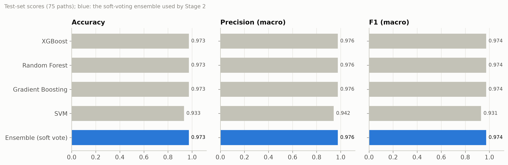
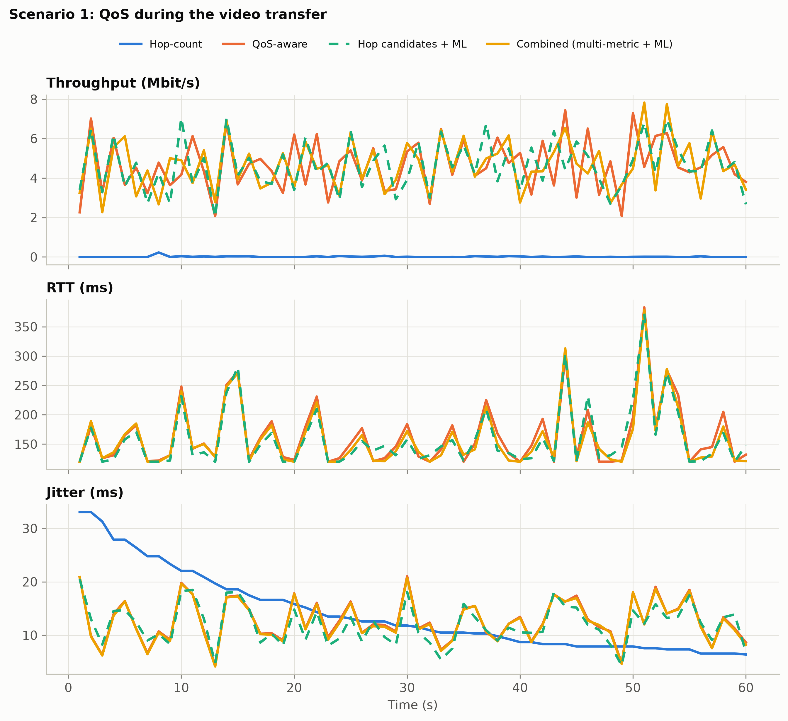
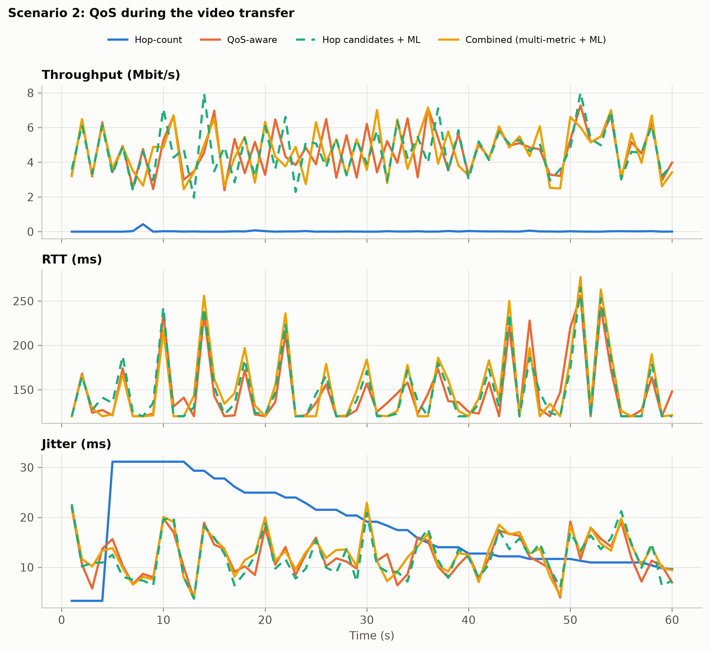
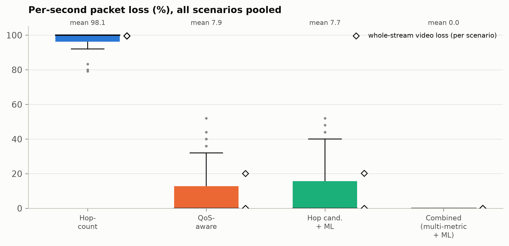
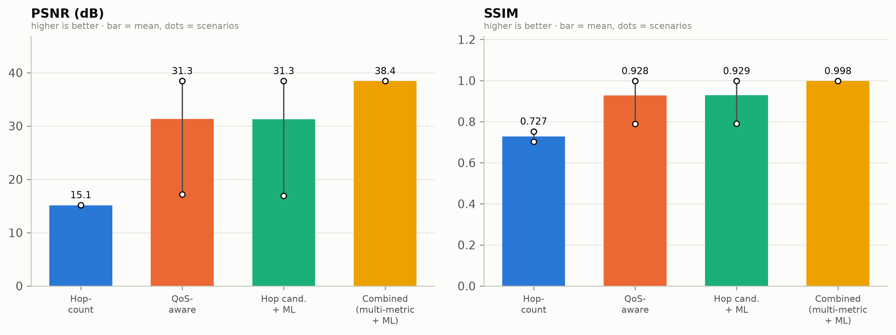
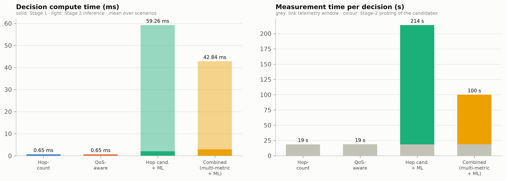
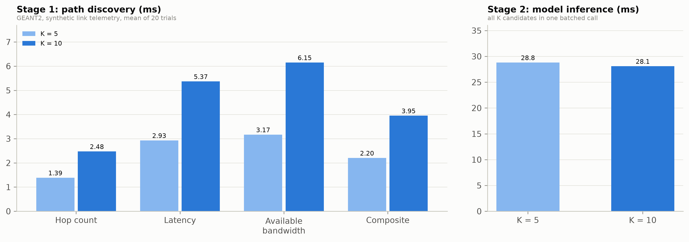

# Multi-Metric Candidate Discovery with Multi-Class Ensemble Selection for Multimedia Routing in SDN: A Combined Two-Stage Architecture on GEANT2

**Technical report**, 20 October 2026 · `geant2-multi-metric-advanced` branch · Builds on İpek et al., *AIRSDN: AI based routing in software-defined networks for multimedia traffic transmission*, Computer Communications 240 (2025), and on this project's `GEANT2` and `improvements` branches.

---

## Abstract

AIRSDN routes multimedia traffic in a software-defined network (SDN). For each flow it takes the five
hop-count shortest paths, probes them, and installs the one a binary classifier labels *low traffic*.
This project extended that design in two separate branches:

- the **GEANT2 branch** moved to the 24-switch GEANT2 network and classified paths into **four congestion
  classes** with an ensemble-grade classifier, but kept hop-count candidates;
- the **improvements branch** introduced a **two-stage pipeline** whose first stage discovers candidates
  with multi-metric algorithms (latency, available bandwidth, a composite cost), but kept AIRSDN's binary
  classifier.

This report presents the architecture that combines them. **Stage 1** computes the top-K candidate paths
(K = 5–10) with one of four interchangeable algorithms. By default it uses Yen's K-shortest paths over a
normalised composite cost of delay, jitter, inverse available bandwidth and loss, measured live from
Floodlight. **Stage 2** probes every candidate for 11 features and scores all of them in one batched
call to a soft-voting ensemble of XGBoost, Random Forest, Gradient Boosting and an RBF SVM. The ensemble
was trained on the GEANT2 branch's 500-path dataset and reaches 97.3 % test accuracy. Stage 2 installs
the candidate with the lowest predicted class, breaking ties on the Stage-1 composite cost.

Four approaches were compared on GEANT2 in Mininet with Floodlight, streaming an H.264 video across the
network diameter. Each ran in three seeded scenarios in which the default shortest path was forced to
*Extremely High* load:

- hop-count routing;
- latency-based QoS-aware routing;
- hop-count candidates with the multi-class ensemble (the GEANT2-branch approach);
- the combined architecture.

**The combined architecture was the only approach to deliver the video without loss in all three
scenarios**: 0.0 % loss, 38.43 dB PSNR, 0.998 SSIM, 161 ms mean RTT. Hop-count routing lost 99.6 % of the
video. QoS-aware routing and the hop-candidate ensemble each lost 20 % of it in scenario 0. Their
candidates did not include any path below *High* load, while the composite Stage 1 offered a 7-hop
*Extremely Low* detour.

Live, the ensemble classified 27 of 30 probed candidates correctly. Every one of its six decisions picked
the least-congested candidate. Routing computation took 2–3 ms for Stage 1 and 34–74 ms for batched
inference. The decision time is dominated by measurement: about 19 s of link telemetry and 67–107 s of
candidate probing.

---

## 1. Introduction

### 1.1 Two partial extensions

AIRSDN [1] has two structural limits:

- **Hop-count candidates.** Ranking candidates by hop count alone means all five can share the same
  congested links. The classifier then chooses the least-bad of several bad paths.
- **Binary labels.** *Low* versus *high* traffic cannot tell a path at 40 % load from one at 5 %.
  Under a multimedia flow of several Mbit/s, that difference decides whether the path saturates.

Each earlier branch removed one of these limits:

| | Candidate discovery | Classifier | Topology |
|---|---|---|---|
| AIRSDN [1] | hop count, K = 5 | Logistic Regression, 2 classes | NSFNET (14 switches) |
| `GEANT2` branch | hop count, K = 5 | Gradient Boosting, **4 classes** | **GEANT2 (24 switches)** |
| `improvements` branch | **hop / latency / widest / composite**, K = 5–10 | Logistic Regression, 2 classes | Fat-Tree, scale-free |
| **this branch** | **hop / latency / widest / composite**, K = 5–10 | **soft-voting ensemble, 4 classes** | **GEANT2 (24 switches)** |

The GEANT2 branch's results show the remaining gap. Its selector always picked the best class among its
candidates, but those candidates are the five shortest paths. When a congested region covers all of
them, a perfect classifier still installs a congested path. The improvements branch showed that
multi-metric discovery produces candidates outside that region. But its binary classifier ranks them
coarsely.

### 1.2 Contributions

1. **A combined pipeline** (Section 2). It integrates multi-metric Stage 1 with
   the four-class GEANT2 classifier. Every candidate carries its composite cost into Stage 2, where the
   cost breaks ties between equally classified candidates.
2. **A soft-voting ensemble** of the four best GEANT2 models, scored in a single batched call. This makes
   inference cost independent of K.
3. **An end-to-end evaluation** on GEANT2 against hop-count, QoS-aware and hop-candidate ML routing,
   covering four areas:
   - per-second throughput, RTT, jitter and loss;
   - per-frame PSNR and SSIM;
   - the ground-truth class of every chosen path;
   - Stage 1 and Stage 2 compute time.
4. **Two measurement corrections** found during the evaluation (Section 3.3).
   - Access-port counters mix background traffic into the video's throughput and loss.
   - Background-flow servers can stay stuck across scenario changes, silently leaving the most congested
     links idle.

**Topology size.** GEANT2 has 24 nodes and 37 links in the RouteNet / DRL-GNN edge list used here, and
the classifier's dataset was collected on exactly this network. The project brief mentioned 30 nodes;
no standard GEANT2 variant has 30, and changing the network would move the Stage 2 features out of the
training distribution.

---

## 2. System Architecture

The branch is organised as five modules in `advanced/`:

| Module | File | Role |
|---|---|---|
| 1 | `topology_builder.py` | GEANT2 in Mininet and NetworkX; 4-class background traffic |
| 2 | `path_discovery.py` | Stage 1: top-K candidates under four togglable metrics, timed |
| 3 | `telemetry_and_model.py` | link telemetry, candidate probing, ensemble, selection, OpenFlow rules |
| 4 | `multimedia_evaluator.py` | H.264 transfer; per-second QoS and per-frame quality |
| 5 | `visualize_benchmarks.py` | comparison figures and tables |

Two scripts drive them: `train_models.py` builds the model bundle and `run_experiment.py` runs the
benchmark.


### 2.1 Network and background traffic (Module 1)

**Network.** GEANT2 is emulated with 24 Open vSwitch switches (OpenFlow 1.3) under Floodlight:

- **Core links:** each of the 37 switch–switch links is shaped to 10 Mbit/s, 10 ms one-way delay and a
  1,000-packet queue. These are the conditions of the dataset.
- **Hosts:** every switch has one host (`h<i>` on `s<i>`) on an unshaped access link.
- **Endpoints:** the Sender is h15 and the Receiver is h23. They are 6 hops apart (the network diameter),
  for a base RTT of 120 ms.
- **Start-up:** the builder disables IPv6 (Floodlight cannot parse its packet marks) and installs static
  ARP entries. It refuses to continue unless `pingAll` loses at most 1 % and the Sender–Receiver pair
  answers.

**Background traffic.** Each link carries one iperf3 UDP constant-bit-rate flow in each direction,
between the hosts at its two ends. The flow is pinned to that link by static entries, so every link's
offered load is known exactly. A scenario assigns each link a load in one of four classes:

| Class | Offered load (fraction of 10 Mbit/s) |
|---|---|
| 0 Extremely Low | 0.00 – 0.25 |
| 1 Low | 0.25 – 0.50 |
| 2 High | 0.50 – 0.80 |
| 3 Extremely High | 0.80 – 1.20 |

A path's **ground-truth class** is the class of its most loaded link. Link classes are drawn with
$P(\text{class} \le c) = ((c+1)/4)^{1/6}$, which makes the bottleneck class of a 6-hop path uniform.
Over 2,000 sampled scenarios, the hop-count candidates fall 22–27 % into each class.

The **video** (H.264, 4.73 Mbit/s) fits into a link only below about 0.5 load. On a *High* link it
saturates the queue.

### 2.2 Telemetry

Before each decision, `LinkTelemetry` samples Floodlight 6 times, 2.5 s apart. The window took
18.7–19.6 s in practice. It derives, per link:

- **Delay and jitter:** mean and standard deviation of the LLDP latency samples (`/wm/topology/links`).
- **Utilisation and available bandwidth:** from the transmitted-byte rate on the port counters
  (`/wm/core/switch/all/port`). Available bandwidth is capacity minus the larger direction's rate.
- **Loss:** 1 − (packets received at the far port) / (packets sent at the near port).

The annotated graph feeds Stage 1. The per-link utilisation also provides Stage 2's two passive features.

### 2.3 Stage 1: multi-metric candidate discovery (Module 2)

All four methods return up to K loopless paths of at most *shortest + 4* hops. Yen's algorithm runs over
a hop-bounded Dijkstra on (node, hops) states:

| Method | Link weight / objective |
|---|---|
| `hop` | 1 per link (the AIRSDN and GEANT2-branch candidates) |
| `latency` | measured delay |
| `bandwidth` | maximise the bottleneck available bandwidth (K widest paths, max-heap Dijkstra) |
| `composite` (default) | normalised weighted sum of delay, jitter, inverse available bandwidth and loss (below) |

The composite cost of link *uv* is

$$c_{uv} = \alpha \frac{D_{uv}}{D_{\max}} + \beta \frac{J_{uv}}{J_{\max}} + \frac{\gamma}{\max\left(B_{uv}/B_{\max},\ 10^{-3}\right)} + \delta L_{uv}$$

In the composite cost, *D* is delay, *J* jitter, *B* available bandwidth and *L* the loss fraction. The
maxima are taken over all links, and the default weights are α = 0.3, β = 0.1, γ = 0.4, δ = 0.2. The
inverse-bandwidth term dominates as a link fills. With the default weights, a link at 71 % load costs 1.8
against about 0.8 for an idle one, so the search detours around loaded links rather than only saturated
ones.

Every candidate's composite cost is computed whatever method produced it, and is passed to Stage 2. Each
call reports its compute time in milliseconds. The four methods are checked against brute-force path
enumeration in the unit tests.

### 2.4 Stage 2: multi-class ensemble selection (Module 3)

**Probing.** For each candidate, the Sender–Receiver ICMP and TCP traffic is pinned onto it with static
entries at priority 40,000, above the route at 32,768. UDP is not pinned, so probing never moves the
video. Each probe measures 11 features, the same as the GEANT2 dataset:

| Group | Features | Source |
|---|---|---|
| Delay | `rtt_avg_ms`, `rtt_min_ms`, `rtt_max_ms`, `rtt_mdev_ms` | 50 pings, 50 ms apart, 5 s reply timeout |
| Loss | `packet_loss_pct` | same pings |
| Capacity | `throughput_mbps`, `bw_utilization_pct`, `retransmits` | 5 s iperf3 TCP, then a 2 s queue drain |
| Structure | `hop_count` | candidate length |
| Controller | `path_max_link_util_pct`, `path_mean_link_util_pct` | telemetry snapshot (Section 2.2) |

**Dataset.** The dataset is the GEANT2 branch's `geant2_dataset.csv`, copied unchanged:

- 500 paths, 125 per class, measured on the live emulated network over 65 traffic epochs;
- labels come from the generator's offered load, never from the measured features.

Its per-class medians show why four classes need throughput and utilisation, not only delay. Background
traffic below link capacity builds no queue, so RTT and loss only separate *Extremely High* from the rest:

| Class | RTT (ms) | Ping loss (%) | TCP throughput (Mbit/s) | Max link util. (%) |
|---|---|---|---|---|
| Extremely Low | 120.2 | 0 | 7.04 | 22.4 |
| Low | 120.3 | 0 | 5.65 | 39.4 |
| High | 120.3 | 0 | 3.18 | 73.5 |
| Extremely High | 2,431.1 | 70 | 0.00 | 100.0 |

**Models.** Four models are retrained:

- XGBoost, with early stopping on the validation set;
- Random Forest (300 trees, balanced class weights);
- Gradient Boosting, the GEANT2 branch's deployed model;
- an RBF SVM on standardised features, with calibrated probabilities.

The first three tied for the best test accuracy in the GEANT2 branch's eight-model comparison. The SVM
was named in the project brief and adds a non-tree model family to the ensemble.

The split is 70 / 15 / 15, stratified, with seed 40. The deployed model is their **soft-voting ensemble**:
the mean of the four class-probability vectors.

| Model | Test accuracy | Macro-F1 | Validation macro-F1 |
|---|---|---|---|
| XGBoost | 0.973 | 0.974 | 0.973 |
| Random Forest | 0.973 | 0.974 | 0.946 |
| Gradient Boosting | 0.973 | 0.974 | 0.987 |
| SVM (RBF) | 0.933 | 0.931 | 0.933 |
| **Soft-voting ensemble** | **0.973** | **0.974** | 0.960 |



The ensemble misclassifies 2 of the 75 test paths. One is a *Low* path predicted as *Extremely Low*. The
other is labelled *Extremely High* (offered load 1.16) but measured 22 % utilisation and 7.4 Mbit/s of TCP
throughput. Its background flow never started (Section 3.3), so the ensemble's *Extremely Low* is the
physically correct answer. Gradient Boosting has the best validation score alone. The ensemble is deployed
because averaging four model families makes its probabilities less brittle than any single model's.

**Selection.** All K candidates are probed first and then classified in one `predict_proba` call. The
selector returns the candidate with the lowest predicted class. Ties go to the lowest composite cost, then
to the Stage-1 rank. Batching keeps inference at about 28 ms offline for both K = 5 and K = 10: calling
the ensemble once per candidate cost about 30 ms each.

### 2.5 Forwarding and evaluation (Module 4)

The chosen route is pushed through Floodlight's StaticEntryPusher. One entry per switch and direction
matches all IPv4 traffic between the Sender and the Receiver. The evaluator then performs four steps:

1. It streams the 66 s test video from h15 to h23 with FFmpeg (`-re -c copy`, MPEG-TS over UDP).
2. It logs one row per second:
   - **RTT:** one ping per second, Receiver to Sender;
   - **jitter and loss:** a 200 kbit/s UDP probe on the same route, with RFC 3550 jitter;
   - **throughput:** the video bytes delivered per second.
3. It counts the whole-stream video packet loss.
4. It scores the received file frame by frame for PSNR and SSIM against the original. Scoring uses
   FFmpeg's native H.264 decoder (imageio-ffmpeg), which conceals errors instead of rejecting a damaged
   stream.

---

## 3. Experimental Setup

### 3.1 Approaches compared

All four approaches use the same network, the same scenario and the same video. They differ only in
Stage 1's method and in whether Stage 2 runs:

| Approach | Stage 1 | Stage 2 | Represents |
|---|---|---|---|
| Hop-count | hop, K = 1 | – | legacy shortest-path routing |
| QoS-aware | latency on measured delay, K = 1 | – | delay-based QoS routing |
| Hop candidates + ML | hop, K = 5 | ensemble | the GEANT2-branch approach (ablation) |
| **Combined** | composite, K = 5 | ensemble | this architecture |

Every approach installs its path as static entries, so all four are measured identically.

### 3.2 Scenarios

There are three scenarios, with seeds 1,000, 1,001 and 1,002. In each, every link's load is drawn from the
4-class model. In addition, all 6 links of the hop-count shortest path, s15–s14–s11–s8–s12–s19–s23, are
forced to *Extremely High*. This is the case that motivates load-aware routing.

Each approach then runs in sequence on the same scenario:

1. a telemetry snapshot;
2. Stage 1;
3. Stage 2, for the ML approaches;
4. route installation;
5. the video transfer.

The traffic was warmed up for 10 s before the first approach. One scenario takes about 14 minutes.

### 3.3 Measurement integrity

Two defects surfaced during the evaluation. Both were corrected before the reported runs.

1. **Background traffic on the endpoint hosts.** The traffic generator also sources and sinks iperf3
   flows at h15 and h23, on the links adjacent to s15 and s23. Their access-port counters therefore
   reported the video plus background traffic: about 10 Mbit/s of "throughput" for a 4.7 Mbit/s video,
   and a loss rate that mixed both.
   - Throughput and loss now come from the OpenFlow counters of the Sender → Receiver route entries on
     the first switch (sent) and the last switch (delivered). The UDP probe's own datagrams are subtracted.
   - On the congested path, the corrected count shows 27,689 video packets sent, which matches the video
     bitrate. The earlier count was 93,098.
2. **Stuck background flows.** When a scenario changes, the old iperf3 clients are killed. On an
   overloaded link the server may never see the end of the test, because the control messages sit in the
   full queue. The server then refuses the next scenario's client as *busy*.
   - The most congested links of one scenario therefore stayed idle in the next. In the first attempt at
     scenario 1, the "Extremely High" default path measured 0 % utilisation and every approach streamed
     loss-free.
   - The generator now restarts its servers with every scenario and verifies that each client is running.
     Scenarios 1 and 2 were re-run with the fix; scenario 0 was the first scenario applied, so it was
     unaffected.
   - The same defect plausibly explains the GEANT2 branch's report of a few dataset rows whose
     "background flow failed to start" (Section 2.4).

---

## 4. Performance Evaluation

### 4.1 Path choices

The ground-truth class of each approach's chosen path is shown below, with the path length:

| Scenario | Hop-count | QoS-aware | Hop candidates + ML | **Combined** |
|---|---|---|---|---|
| 0 | Extremely High (6) | High (6) | High (6) | **Extremely Low (7)** |
| 1 | Extremely High (6) | Low (6) | Low (6) | **Low (6)** |
| 2 | Extremely High (6) | Extremely Low (6) | Extremely Low (6) | **Extremely Low (6)** |

In scenarios 1 and 2, the path s15–s16–s17–s18–s21–s22–s23 was the best available. QoS-aware routing,
both ML approaches, and the composite Stage-1 rank-0 candidate all chose it.

**Scenario 0** separates the approaches. Link s17–s18 on that path carried 71 % load (*High*).

- **QoS-aware routing** cannot see that load: a link below capacity has no queue, so its latency stays at
  10 ms.
- **The hop-count candidates** of the ML ablation were 4 × *Extremely High* and 1 × *High*. The ensemble
  classified all five correctly and picked the *High* one, which was the best option it was given.
- **The composite Stage 1** priced s17–s18 at more than twice an idle link. In the measured telemetry,
  the two-link detour s17–s8–s18 over lightly loaded links came out cheaper. Its rank-0 candidate was
  therefore a 7-hop path on which every link was *Extremely Low*.


The Stage-1 candidate sets in scenario 0 show where the difference comes from. The table gives the true
class and, in brackets, the ensemble's prediction; ✔ marks the chosen candidate:

| Rank | Hop candidates + ML | Combined (composite candidates) |
|---|---|---|
| 0 | 6 hops · Extremely High (EH) | 7 hops · **Extremely Low (EL)** ✔ |
| 1 | 6 hops · Extremely High (EH) | 6 hops · High (H) |
| 2 | 6 hops · High (H) ✔ | 10 hops · Extremely High (EH) |
| 3 | 7 hops · Extremely High (EH) | 7 hops · Extremely High (EH) |
| 4 | 7 hops · Extremely High (EH) | 9 hops · Extremely High (EH) |

### 4.2 Summary

Means over the three scenarios:

| Approach | Video loss (%) | PSNR (dB) | SSIM | RTT (ms) | Jitter (ms) | Throughput (Mbit/s) | Frames decoded |
|---|---|---|---|---|---|---|---|
| Hop-count | 99.58 | 15.13¹ | 0.727¹ | –² | 24.08 | 0.02 | 12 |
| QoS-aware | 6.70 | 31.34 | 0.928 | 504.6 | **12.01** | 4.32 | 3,698 |
| Hop candidates + ML | 6.76 | 31.26 | 0.929 | 510.2 | 12.23 | 4.31 | 3,684 |
| **Combined** | **0.00** | **38.43** | **0.998** | **160.5** | 12.86 | **4.65** | **3,968** |

¹ Over scenarios 0 and 2. In scenario 1 not a single frame of the video could be decoded.
² All echoes were lost: the path dropped 99 % of packets in each direction.

Per scenario:

| Scenario | Approach | Loss (%) | PSNR (dB) | SSIM | RTT (ms) | Throughput (Mbit/s) |
|---|---|---|---|---|---|---|
| 0 | Hop-count | 99.44 | 15.10 | 0.702 | – | 0.03 |
| 0 | QoS-aware | 20.11 | 17.15 | 0.789 | 1,202.5 | 3.67 |
| 0 | Hop candidates + ML | 20.29 | 16.92 | 0.791 | 1,223.7 | 3.63 |
| 0 | **Combined** | **0.00** | **38.43** | **0.998** | **171.2** | **4.64** |
| 1 | Hop-count | 99.70 | – | – | – | 0.02 |
| 1 | QoS-aware | 0.00 | 38.43 | 0.998 | 163.9 | 4.66 |
| 1 | Hop candidates + ML | 0.00 | 38.43 | 0.998 | 158.1 | 4.65 |
| 1 | **Combined** | 0.00 | 38.43 | 0.998 | 159.5 | 4.66 |
| 2 | Hop-count | 99.61 | 15.17 | 0.752 | – | 0.02 |
| 2 | QoS-aware | 0.00 | 38.43 | 0.998 | 147.4 | 4.65 |
| 2 | Hop candidates + ML | 0.00 | 38.43 | 0.998 | 148.8 | 4.65 |
| 2 | **Combined** | 0.00 | 38.43 | 0.998 | 151.0 | 4.64 |

**The PSNR ceiling.** 38.43 dB / 0.998 SSIM is the ceiling of this measurement. A loss-free run
reproduces 3,967 of the 4,007 reference frames bit for bit (infinite PSNR). The last 40 frames, about
1 s of video, are never captured because the receiver stops with the stream. Averaging over those 40
frames sets the ceiling.

### 4.3 Throughput, RTT and jitter over time


The scenario-0 time series shows the mechanism behind the losses. On the *High* path, the video's
4.7 Mbit/s plus 7.1 Mbit/s of background traffic exceeds the 10 Mbit/s link:

- **RTT** climbs within the first 6 s to the full-queue value: 1,000 packets of about 1.3 kB take
  1.1 s to drain at 10 Mbit/s.
- **Loss** holds at about 20 % from then on.
- **Throughput** on that path fluctuates around 3.6 Mbit/s, below the video's rate.

On the combined path, throughput tracks the video's own rate. Its peaks of 6–8 Mbit/s are bursts of the
variable-bitrate stream, not congestion.





**Jitter** is similar on every usable path (12–13 ms): it is dominated by the video's own burstiness.
It does not discriminate between the approaches here.

### 4.4 Packet loss



The per-second probe loss confirms the whole-stream video loss:

- **Hop-count:** a median of 100 %.
- **QoS-aware and hop-candidate ML:** zero in scenarios 1 and 2, but 20–50 % per second throughout
  scenario 0.
- **Combined:** no second with measurable loss in any scenario. The single lost video packet in
  scenario 2 (0.004 %) also appears for the hop-candidate ensemble on the same path.

### 4.5 Video quality



Hop-count delivers at most 21 decodable frames out of 4,007, and none in scenario 1. In scenario 0, QoS-aware routing and
the hop-candidate ensemble decode about 3,140 frames, but the error-concealed frames bring PSNR down to
17 dB, which is unwatchable. The combined architecture's 0 % loss gives the measurement's ceiling in all
three scenarios.

### 4.6 Stage 2 in the live network

Across the six ML decisions, 30 candidates were probed and classified by the ensemble:

| True class \ Predicted | EL | L | H | EH |
|---|---|---|---|---|
| Extremely Low | **3** | 0 | 0 | 0 |
| Low | 0 | **7** | 0 | 0 |
| High | 0 | 0 | **2** | 0 |
| Extremely High | 0 | 0 | 3 | **15** |

Live accuracy is **90 %** (27 / 30). All three errors are in scenario 2, on composite candidates of 7, 9
and 10 hops whose bottleneck carried *Extremely High* load: the ensemble placed them one class lower, at
*High*. The training paths have 2–7 hops, so the 9- and 10-hop candidates lie outside the dataset.
**None of the errors changed a decision.** In every scenario, the
selected path was the least-congested candidate available.

### 4.7 Computational latency



| Approach | Stage 1 (ms) | Stage 2 inference (ms) | Telemetry (s) | Candidate probing (s) |
|---|---|---|---|---|
| Hop-count | 0.65 | – | 18.7 | – |
| QoS-aware | 0.65 | – | 18.9 | – |
| Hop candidates + ML | 2.02 | 57.2 | 18.7 | 195.3 |
| **Combined** | 2.94 | 39.9 | 19.0 | **81.0** |

**Compute time.** Computation is negligible next to measurement.

- Stage 1 stays below 3.4 ms, with the composite cost about 1 ms above hop count.
- Live inference (34–74 ms) is above the offline 28 ms because Mininet, Open vSwitch and up to 74 iperf3 flows
  share the same CPU.

**Probing time.** Probing dominates the decision.

- The combined architecture probes its 5 candidates in 67–107 s, against 195 s for hop candidates. Probing
  a saturated candidate waits out ping and iperf3 timeouts.
- The composite candidates are mostly unloaded, so better candidates also make Stage 2 faster.



Offline, all four Stage-1 methods stay between 1.4 and 6.2 ms up to K = 10:

| | K = 5 | K = 10 |
|---|---|---|
| Hop count | 1.39 ms | 2.48 ms |
| Latency | 2.93 ms | 5.37 ms |
| Available bandwidth | 3.17 ms | 6.15 ms |
| Composite | 2.20 ms | 3.95 ms |
| Stage 2 inference (batched) | 28.8 ms | 28.1 ms |

---

## 5. Discussion and Threats to Validity

**Candidate quality bounds the selector.** In scenario 0, the ensemble was exact on all five hop-count
candidates and still installed a path that lost 20 % of the video. No classifier can choose a path it is
not shown. The composite Stage 1 helps precisely where hop-count candidates overlap a congested region:
its inverse-bandwidth term reveals moderate load that latency cannot.

**Four classes matter for multimedia.** A 4.7 Mbit/s stream saturates a 10 Mbit/s link above about 0.5
background load. *High* (0.5–0.8) is therefore already unusable for this video. A binary low/high
classifier would have to put its boundary inside that range to separate usable from unusable paths.

**Threats to validity.**

- **Sample size.** There are three scenarios, and only one (scenario 0) distinguishes the combined
  architecture from QoS-aware and hop-candidate routing. The mean differences in Section 4.2 come from
  that scenario. More seeds are needed before generalising (`SCENARIOS=10 advanced/run_all.sh`).
- **Forced congestion.** `--congest-default-path` constructs the case in which load-aware routing should
  help. Without it, the shortest path is often uncongested, and the approaches converge.
- **Static scenarios.** Background load is constant while each approach runs, and routes are not
  re-evaluated during the stream. Each approach measures a fresh telemetry snapshot of the same
  scenario, so the approaches see the same load, but not in the same seconds.
- **Homogeneous links.** All links have 10 ms delay, which makes the latency metric uninformative below
  saturation. `--delay-range` gives heterogeneous delays, but moves RTT features out of the training
  distribution.
- **Training labels.** The dataset contains a small number of rows mislabelled by the stuck-flow defect
  (Section 3.3). One appears among the ensemble's two test-set errors.
- **Measurement time.** One to two minutes of probing per decision suits long-lived flows such as video
  sessions, not per-flow routing of short transfers.

---

## 6. Conclusion and Future Work

The combined architecture joins multi-metric candidate discovery with multi-class ensemble selection on
GEANT2. In three forced-congestion scenarios it was the only approach that never routed the video
through a congested link. It delivered all three streams without loss at the measurement's quality
ceiling: 38.43 dB PSNR, 0.998 SSIM and 161 ms mean RTT. Hop-count routing lost 99.6 % of the video, and
QoS-aware and hop-candidate ML routing each lost 20 % of it when their candidates offered nothing better
than a *High* path.

The ensemble classified 90 % of live candidates correctly, and its errors never changed a decision.
Stage 1 and Stage 2 together cost under 0.1 s of computation. Probing remains the expensive step, and it
became cheaper with better candidates.

### Future work

- **More scenarios.** Evaluate without forced congestion, and with heterogeneous link delays, to measure
  how often the composite detour matters in the average case.
- **Shorter probing.** Classify from passive telemetry alone (port counters, LLDP), or probe only the
  candidates whose passive features are ambiguous. This would cut the 67–195 s probing time.
- **Continuous re-evaluation.** Re-run Stage 1 cheaply on every telemetry update, and re-probe only when
  the chosen path's composite cost rises.
- **Dataset.** Re-collect it with the stuck-flow fix to remove label noise, and add longer paths, which
  produced the live misclassifications.
- **Weight tuning.** Tune α, β, γ and δ on recorded scenarios rather than fixing them by hand.

---

## Appendix A: Reproduction

```bash
git switch geant2-multi-metric-advanced
.venv/bin/pip install -r requirements.txt

# no root: tests, training, offline timing
.venv/bin/python -m pytest advanced/tests -q
.venv/bin/python advanced/train_models.py
.venv/bin/python advanced/run_experiment.py --benchmark-only

# live benchmark (Floodlight in a separate terminal)
./start_floodlight.sh
sudo .venv/bin/python advanced/run_experiment.py \
    --scenarios 3 --congest-default-path
.venv/bin/python advanced/visualize_benchmarks.py \
    results/advanced/<run> \
    --benchmark results/advanced/decision_latency_benchmark.csv

# or all of the above in one script
advanced/run_all.sh

# this report as a PDF
advanced/report/build_pdf.sh
```

## Appendix B: Artefacts

| Artefact | Location |
|---|---|
| Dataset (from the GEANT2 branch) | `advanced/data/geant2_dataset.csv` |
| Model bundle (4 models + ensemble) | `advanced/models/multiclass_bundle.joblib` |
| Training metrics and figure | `advanced/results/training/` |
| Reported run (raw, git-ignored) | `results/advanced/advanced_20261020_202810/` |
| Reported run figures and tables (committed copy) | `advanced/report/figures/run/`, `advanced/report/data/` |
| Architecture and scenario diagrams | `advanced/report/figures/`, built by `advanced/report/make_figures.py` |

## References

[1] İpek, A. D., et al. (2025). AIRSDN: AI based routing in software-defined networks for multimedia
traffic transmission. *Computer Communications*, 240.

[2] Rusek, K., et al. (2020). RouteNet: Leveraging graph neural networks for network modeling and
optimization in SDN. *IEEE Journal on Selected Areas in Communications*, 38(10). (Source of the GEANT2
edge list.)

[3] Yen, J. Y. (1971). Finding the K shortest loopless paths in a network. *Management Science*, 17(11).
