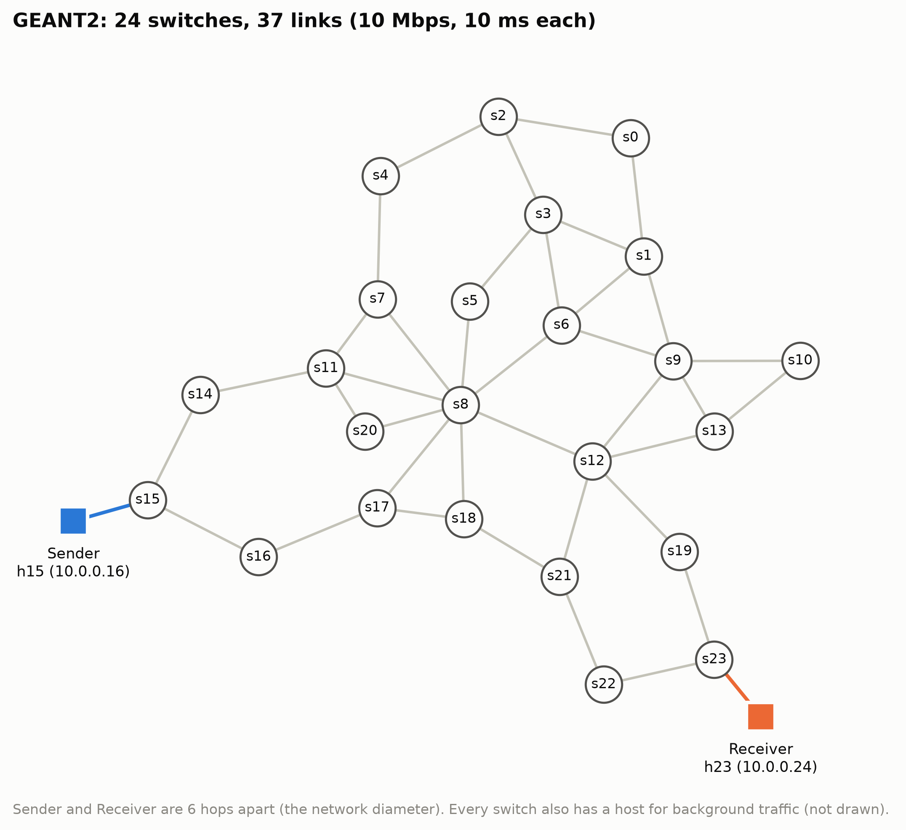
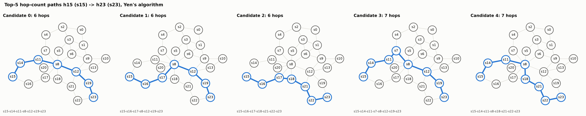
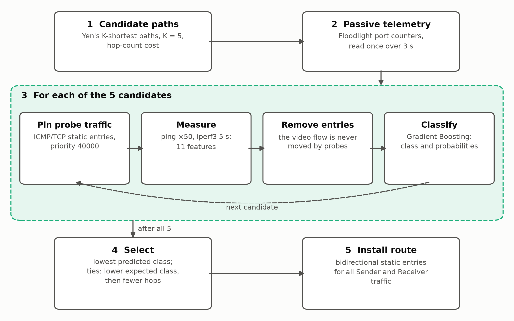
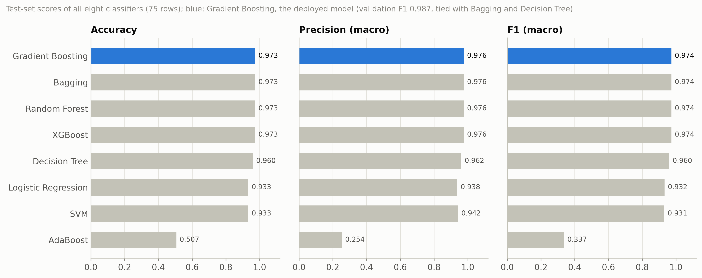
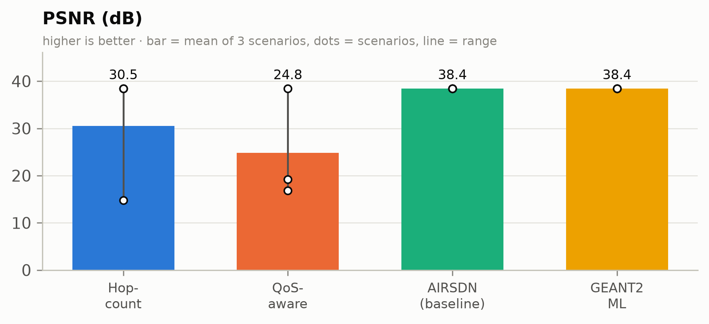
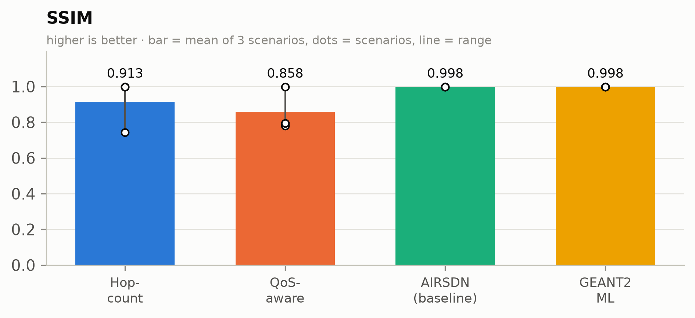
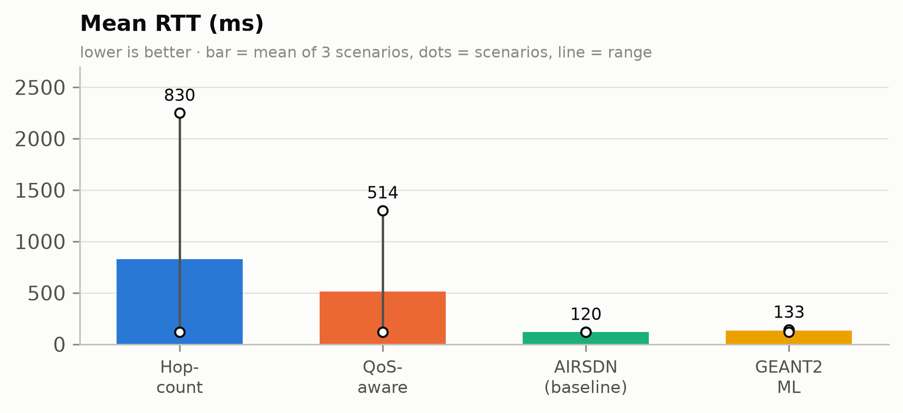
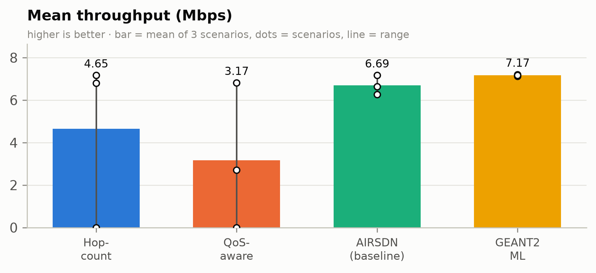
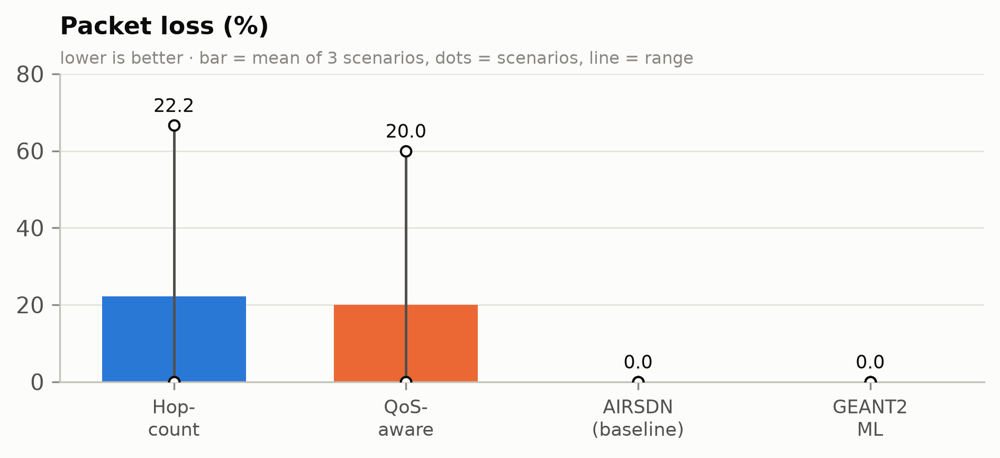

# Multi-Class Congestion-Aware Path Selection for Multimedia Traffic in SDN: Extending AIRSDN to the GEANT2 Topology

**Technical report**, 20 October 2026 · Extension of İpek et al., *AIRSDN: AI based routing in software-defined networks for multimedia traffic transmission*, Computer Communications 240 (2025).

---

## Abstract

AIRSDN routes multimedia traffic in a software-defined network (SDN). For each flow it takes the five
shortest candidate paths, probes each one, and labels it *low* or *high* traffic with a binary Logistic
Regression classifier. It was evaluated on the 14-node NSFNET topology. This report extends the approach
along three axes.

1. **Topology scale.** The pan-European GEANT2 research network: 24 switches and 37 links in Mininet,
   controlled by Floodlight. The Sender and Receiver sit at the network diameter (6 hops).
2. **Label resolution.** Paths are classified into four congestion states instead of two: *Extremely Low*,
   *Low*, *High* and *Extremely High*. The states are produced by a controlled per-link traffic generator,
   and the generator's offered load provides the ground-truth labels.
3. **Model selection.** Eight classifiers are compared: linear, kernel, single-tree, bagging and boosting
   families.

The dataset has 500 class-balanced paths measured on the emulated network. On a held-out test set,
Gradient Boosting, XGBoost, Random Forest and Bagging all reach **97.3 % accuracy** (macro-F1 0.974).
Gradient Boosting is deployed in the controller.

Four routing approaches were compared over three seeded traffic scenarios:

- Floodlight hop-count routing;
- Floodlight QoS-aware (latency) routing;
- the original AIRSDN;
- the proposed multi-class selector.

The proposed method chose a path whose true state was *Extremely Low* in every scenario. It delivered the
H.264 test video at **38.4 dB PSNR / 0.998 SSIM with 0 % packet loss**, and had the highest throughput of
all approaches (**7.17 Mbps** on average). Hop-count routing averaged 30.5 dB and QoS-aware routing
24.8 dB; each collapsed below 17 dB PSNR when it routed into a congested path. AIRSDN matched the
proposed method's video quality but, unable to tell *Low* from *Extremely Low*, settled for busier paths
with 7 % lower throughput. It also took 2–4× longer to decide.

---

## 1. Introduction

Multimedia streams are sensitive to queueing delay and loss, and need sustained bandwidth. In SDN the
controller has a global view and can pin a flow to any path. Choosing the *right* path, though, requires
an estimate of each path's current congestion. Two common strategies fall short.

- **Hop-count routing** (the default in controllers such as Floodlight) ignores load entirely. When the
  shortest path crosses a saturated link, the stream is routed into the congestion, however many idle
  alternatives exist.
- **Latency-based QoS routing** uses a congestion signal, but an indirect and lagging one. Link delays are
  estimated from periodic discovery probes and react only once queues have already built up. Constant-rate
  background traffic below link capacity does not raise latency at all (Section 4.4).

AIRSDN replaced these heuristics with a learned estimate. It probed each candidate path end to end and
classified it with a binary model. Two limits of that design motivate this work:

1. **Binary labels are coarse.** A *low*-traffic label covers both an idle path and one that is 40 %
   utilised. When several candidates are uncongested, a binary model cannot rank them, so it cannot pick
   the one with the most headroom.
2. **The evaluation was small.** A 14-node network with a single traffic scenario says little about how
   the approach behaves in a larger topology with more path diversity and changing load.

### Objectives

- **O1.** Implement a larger, realistic topology (GEANT2) in Mininet with Floodlight, with explicitly
  designated Sender and Receiver hosts at the network diameter.
- **O2.** Build a traffic generator that drives every link through four controlled utilisation states,
  and produce a balanced, ground-truth-labelled dataset of path telemetry.
- **O3.** Train and compare multi-class classifiers from several model families, and select the deployed
  model on held-out data.
- **O4.** Integrate the selected model into the controller's routing loop, and evaluate it against
  hop-count, QoS-aware and the original AIRSDN routing on live H.264 video transfer.

---

## 2. System Architecture

The system has four layers:

- the emulated data plane (Mininet with Open vSwitch);
- the controller (Floodlight, through its REST API);
- a measurement and learning layer;
- an evaluation layer.

All code is in the `geant2/` directory of the repository. Baseline components are reused unchanged: the
static-flow installer, Yen's algorithm, AIRSDN's path prober and classifier, and the video evaluator.


### 2.1 Network topology

| Property | Value |
|---|---|
| Graph | GEANT2 as used in RouteNet / DRL-GNN: **24 switches, 37 bidirectional links**, diameter 6 hops |
| Switch–switch links | 10 Mbps, 10 ms one-way delay, 1,000-packet queue (Linux HTB via Mininet `TCLink`) |
| Hosts | One per switch (`h0`–`h23`, `10.0.0.1`–`10.0.0.24`); access links unshaped, so they are never the bottleneck |
| Switches / OpenFlow | Open vSwitch (kernel datapath), OpenFlow 1.3 |
| Controller | Floodlight (master branch), reactive forwarding plus StaticEntryPusher |
| **Sender** | **`h15` on `s15`**, the video source |
| **Receiver** | **`h23` on `s23`**, the video sink, 6 hops from the Sender (the network diameter) |

The topology module exposes three scaling parameters: hosts per switch, link bandwidth and link delay.
The experiments below use the defaults.

The Sender–Receiver pair was chosen among the five pairs at the network diameter because its candidate
set is diverse. Four of its five shortest paths cross the `s8` hub, but one
(`s15-s16-s17-s18-s21-s22-s23`) avoids both `s8` and `s12`, so routing choices lead to genuinely
different loads.





**Implementation note: controller stability.** With IPv6 enabled on the switch ports, link-local IPv6
traffic reached Open vSwitch carrying a packet mark. Open vSwitch then reported a `pkt_mark` field in its
PacketIn messages, which Floodlight's OpenFlow library cannot parse. Floodlight dropped the switch
connections, and in one case left the Sender's switch unroutable. A controlled test confirmed the cause:
22 parse errors in 45 s with IPv6 enabled, and none without. The network is therefore started with IPv6
disabled. Hosts also get static ARP entries, so address resolution never depends on reactive paths across
congested links.

### 2.2 Multi-class traffic generation

Each of the 37 links carries one **iperf3 UDP constant-bit-rate flow in each direction**, between the
hosts at its two ends. Static flow entries pin each flow onto exactly that link, so the offered load of
every link is known precisely. The load, as a fraction of link capacity, falls into one of four states:

| Class | Offered load (fraction of capacity) | Expected effect |
|---|---|---|
| 0 Extremely Low | 0.00 – 0.25 | Ample headroom |
| 1 Low | 0.25 – 0.50 | Moderate headroom |
| 2 High | 0.50 – 0.80 | Little headroom for a ~4.5 Mbps video |
| 3 Extremely High | 0.80 – 1.20 | Saturation: the queue fills and packets are dropped |

**Dynamics.** A new *scenario* (one load per link, the same in both directions) is drawn every
measurement epoch of 2–3 minutes. Link utilisation therefore fluctuates continuously during data
collection.

**Path labels.** A path's ground-truth class is the class of its **most loaded link** (its bottleneck),
computed from the generator's offered loads. Measured features are never used for labelling.

**Class balance.** Drawing each link's class uniformly would make almost every multi-hop path
*Extremely High*. Instead, link classes are drawn with weights that make the bottleneck class of an
*h*-hop path uniform:

$$P(\text{link class} \le c) = \left(\tfrac{c+1}{4}\right)^{1/h}, \quad h = 6$$

On the Sender–Receiver candidates this yields 22–27 % of paths per class. During collection, 70 % of
epochs are additionally *targeted*: link classes are capped at the class that is furthest behind its
quota, with 30 % of links in that class. 85–100 % of probed paths then land in the target class, which
keeps the dataset balanced without biasing the labels.

**Generator fidelity.** Floodlight's port counters measured, on a typical row, 0.9 percentage points more
load than the generator set (UDP and IP header overhead). 99 % of rows agree within 10 points. In 3 of
500 rows (0.6 %), a background flow failed to start, so the measured load was far below the label. Those
rows are kept, as known label noise (Section 3.3).

### 2.3 Path telemetry

For each candidate path, the path's ICMP and TCP traffic is pinned onto it with high-priority static
entries, and 11 features are measured:

| Group | Features | Source |
|---|---|---|
| Delay | `rtt_avg_ms`, `rtt_min_ms`, `rtt_max_ms`, `rtt_mdev_ms` (jitter) | 50 pings at 50 ms intervals, Sender → Receiver |
| Loss | `packet_loss_pct` | Same ping series |
| Capacity | `throughput_mbps`, `bw_utilization_pct` (= 1 − throughput/capacity), `retransmits` | 5 s iperf3 TCP probe |
| Structure | `hop_count` | Path length |
| Controller | `path_max_link_util_pct`, `path_mean_link_util_pct` | Floodlight port counters read twice, 3 s apart, before any probe |

Two corrections were needed to make these measurements sound:

1. **Ping counting.** Ping is run with a fixed request count and a reply timeout (`-c 50 -W 5`). The
   alternative, a deadline (`-w`), keeps sending until 50 replies arrive. It then counts the 1–2 requests
   still in flight as lost, which produced a spurious 2–4 % loss on every path.
2. **Queue drain.** After each TCP probe, the collector pauses 2 s so the probe's own queue (up to 1.2 s
   per link) drains before the next path is measured.

### 2.4 Dataset

| Property | Value |
|---|---|
| Size | **500 paths**, 125 per class |
| Collection | 65 epochs on the live emulated network |
| Paths | 317 Sender → Receiver candidate measurements, plus 183 paths between random host pairs (2–7 hops) |
| Integrity checks | One epoch measured across a host suspend was removed. Rows showing 100 % ping loss on a path below 80 % load are discarded as measurement failures (one such row). |
| File | `geant2/data/geant2_dataset.csv` |

Median measurements per class:

| Class | Bottleneck load | RTT (ms) | Jitter (ms) | Ping loss (%) | TCP throughput (Mbps) | Controller max util. (%) |
|---|---|---|---|---|---|---|
| Extremely Low | 0.22 | 120.2 | 0.34 | 0 | 7.04 | 22.4 |
| Low | 0.39 | 120.3 | 0.41 | 0 | 5.65 | 39.4 |
| High | 0.71 | 120.3 | 0.41 | 0 | 3.18 | 73.5 |
| Extremely High | 1.07 | 2431.1 | 5.22 | 70 | 0.00 | 100.0 |

The three lower classes differ clearly in throughput and utilisation, but not in RTT or loss. Background
UDP traffic below link capacity does not build queues, so delay-based signals only detect congestion once
a link saturates.

### 2.5 Classifier training and selection

The dataset is split 70 / 15 / 15 into training, validation and test sets (350 / 75 / 75 rows), stratified
by class. This is the same protocol as the baseline. Eight classifiers are trained:

- **Linear:** Logistic Regression (standardised features, balanced class weights).
- **Kernel:** SVM with an RBF kernel (standardised features, probability outputs via explicit calibration).
- **Single tree:** Decision Tree (balanced class weights).
- **Bagging:** Random Forest (300 trees); Bagging over 100 decision trees.
- **Boosting:** AdaBoost (200 estimators); Gradient Boosting; XGBoost (`multi:softprob`, early stopping
  on the validation set).

Models are selected on **validation macro-F1**. Macro-F1 weights all four classes equally, so it penalises
a model that sacrifices a rare or hard class. The test set is used only for reporting.

### 2.6 Intelligent routing pipeline

For each Sender → Receiver decision, the controller:

1. **Computes candidates.** The top-5 loopless paths by hop count, using Yen's K-shortest-paths algorithm.
   The result was cross-checked against Floodlight's own `/wm/routing/paths` API: its top-3 paths match
   candidates 0–2 exactly.
2. **Reads passive telemetry.** It reads link utilisation from Floodlight's port counters once.
3. **Probes each candidate.** For each of the 5 candidates, it installs temporary ICMP/TCP-only static
   entries (priority 40000), measures the 11 features, removes the entries, and predicts the class with
   the trained model.
4. **Selects a path.** It picks the candidate with the **lowest predicted class**. Ties are broken first
   by the lower probability-weighted class $\sum_c c \cdot p_c$, then by hop count.
5. **Installs the route.** It pushes bidirectional static entries for all Sender ↔ Receiver traffic on the
   chosen path, using Floodlight's StaticEntryPusher.

The probes match only ICMP and TCP, so probing never moves the UDP video stream.



---

## 3. Classification Results

### 3.1 Model comparison

All eight models, all 11 features, on the 75-row test set:

| Model | Family | Accuracy | Precision (macro) | Recall (macro) | **F1 (macro)** | Validation F1 | Inference (ms/path) |
|---|---|---|---|---|---|---|---|
| **Gradient Boosting** (deployed) | Boosting | **0.973** | **0.976** | **0.973** | **0.974** | **0.987** | 0.013 |
| XGBoost | Boosting | 0.973 | 0.976 | 0.973 | 0.974 | 0.973 | 0.234 |
| Random Forest | Bagging | 0.973 | 0.976 | 0.973 | 0.974 | 0.946 | 0.177 |
| Bagging (decision trees) | Bagging | 0.973 | 0.976 | 0.973 | 0.974 | **0.987** | 0.115 |
| Decision Tree | Single tree | 0.960 | 0.962 | 0.960 | 0.960 | **0.987** | 0.002 |
| Logistic Regression | Linear | 0.933 | 0.938 | 0.932 | 0.932 | 0.933 | 0.005 |
| SVM (RBF) | Kernel | 0.933 | 0.942 | 0.931 | 0.931 | 0.933 | 0.021 |
| AdaBoost | Boosting | 0.507 | 0.254 | 0.500 | 0.337 | 0.327 | 0.233 |



### 3.2 Selection of the deployed model

**Validation tie.** Gradient Boosting, Bagging and Decision Tree tie at the top of validation macro-F1
(0.987). A 75-row validation set cannot separate them: each is one misclassification away from the
others.

**Why Gradient Boosting.** It was selected and deployed from the four-model comparison (Gradient Boosting,
XGBoost, Random Forest, SVM), where it alone had the highest validation F1. In the eight-model comparison
it also has the best test performance among the tied models: 0.974 test F1, against 0.960 for the
Decision Tree. Its inference cost (0.013 ms per path) is negligible next to the seconds of probing.

**Families.**

- Tree ensembles of both kinds, bagging and boosting, form a clear top tier.
- The linear and kernel models trail by about 4 points. Linear class boundaries struggle with the sharp
  non-linear transition into saturation (Section 2.4).
- AdaBoost, with its default decision-stump base learner, fails to separate four classes (macro-F1 0.337).
  It is reported for completeness rather than tuned.

### 3.3 Error analysis

**Confusion matrix.** Gradient Boosting on the test set (rows: actual; columns: predicted):

| | Extremely Low | Low | High | Extremely High |
|---|---|---|---|---|
| **Extremely Low** | 19 | 0 | 0 | 0 |
| **Low** | 1 | 18 | 0 | 0 |
| **High** | 0 | 0 | 19 | 0 |
| **Extremely High** | 1 | 0 | 0 | 17 |

**The two errors.** Both are explained by the data, not by the model:

- The *Extremely High* row predicted *Extremely Low* is one of the 0.6 % mislabelled rows. Its background
  flow did not run, so the path measured idle: base RTT, 0 % loss, 7.4 Mbps, 22 % utilisation. The
  prediction matches what the network was actually doing.
- The *Low* row predicted *Extremely Low* has measured utilisation (24.6 %) at the class boundary.

**Feature importance.** Controller-measured link utilisation (`path_max_link_util_pct`) carries 82 % of
Gradient Boosting's feature importance. TCP throughput and bandwidth utilisation account for about 9 %
each.

**Ablation without controller features.** To check that the result does not depend on controller counters,
all eight models were retrained on the 9 end-to-end features only (`--feature-set active`). Bagging,
boosting and the single tree all still reach 0.973 test accuracy. Logistic Regression drops to 0.933 and
SVM to 0.907. End-to-end measurements alone therefore suffice for the tree ensembles; the controller
features make the decision boundary simpler rather than enabling it.

**Online accuracy.** During the routing experiments, the deployed model classified the 15 live
candidates (3 scenarios × 5 paths) with 12 exactly correct. The 3 errors were each off by one class, and
each sat at a class boundary: for example, 82 % measured utilisation against an 80 % threshold. None of
them changed the path chosen.

---

## 4. Performance Evaluation

### 4.1 Experimental setup

**Scenarios.** Three traffic scenarios were drawn with fixed seeds (1000–1002), with no targeting. Each
scenario's link loads are applied once and held constant while all four approaches are evaluated in turn,
so every approach faces identical conditions.

**Approaches:**

| Approach | Path selection |
|---|---|
| Hop-count | Floodlight reactive forwarding, hop-count metric |
| QoS-aware | Floodlight reactive forwarding, latency metric (LLDP-measured link delay) |
| AIRSDN (baseline) | The original method, unchanged: 5 hop-count candidates, 19 features (ping flood, 30 s iperf3, NFStream flow statistics), binary Logistic Regression trained on the NSFNET dataset, lowest predicted level |
| **Proposed** | 5 hop-count candidates, 11 features, 4-class Gradient Boosting, lowest predicted class |

**Measurements on the selected route.** These follow the baseline protocol:

- RTT and packet loss from 60 pings at 1 s intervals;
- throughput from a 60 s iperf3 TCP transfer (Sender → Receiver);
- **multimedia quality** from a 66 s H.264 test sequence (`surreal.ts`: 1920 × 1048, about 61 fps, 4,007
  frames). FFmpeg streams it from the Sender to the Receiver over UDP in real time (`-re -c copy`), and the
  received stream is compared frame by frame with the original.

**Quality scoring.** PSNR and SSIM are computed with FFmpeg's `psnr` and `ssim` filters, using FFmpeg's
native H.264 decoder. That decoder conceals errors, which is the standard way to score damaged video.
The system FFmpeg build, whose only H.264 decoder is OpenH264, could not decode heavily damaged streams at
all. "Frames decoded" counts the frames actually recovered from the received stream.

**Unmeasurable throughput.** When a path is too congested for iperf3 to keep its connection open, the
throughput is recorded as 0 Mbps rather than omitted, so the mean does not flatter the approach that
chose that path.

### 4.2 Path choices

Ground-truth class of each approach's chosen path:

| Scenario | Hop-count | QoS-aware | AIRSDN | **Proposed** |
|---|---|---|---|---|
| 0 | Low | **High** | Low | **Extremely Low** |
| 1 | **Extremely High** | Low¹ | Low | **Extremely Low** |
| 2 | Extremely Low | Extremely Low | Extremely Low | **Extremely Low** |

¹ QoS-aware routing re-routes each traffic flow reactively, as its latency estimates change. In scenario 1
its ping and TCP measurements hit congested routes during the run, even though the first path chosen was
*Low* (Section 4.3).

- **Proposed:** the only approach that selected a path in the least-congested class in every scenario.
- **Hop-count:** has no load signal, so its outcome depends on whether the shortest path happens to be
  congested. In scenario 1 it was.
- **QoS-aware:** in scenario 0 it chose a *High* path. Moderate constant-rate load does not raise link
  latency (Section 2.4), so the latency metric could not see it.

### 4.3 Results

Mean over three scenarios. In the figures, dots show the individual scenarios and lines span their range:

| Approach | **PSNR (dB)** | **SSIM** | **RTT (ms)** | **Throughput (Mbps)** | **Packet loss (%)** | Frames decoded (of 4,007) |
|---|---|---|---|---|---|---|
| Hop-count | 30.55 | 0.913 | 830.2 | 4.65 | 22.2 | 2,907 |
| QoS-aware | 24.82 | 0.858 | 514.1 | 3.18 | 20.0 | 3,667 |
| AIRSDN (baseline) | 38.43 | 0.998 | **120.1** | 6.69 | **0.0** | **3,968** |
| **Proposed (GEANT2 multi-class)** | **38.43** | **0.998** | 133.3 | **7.17** | **0.0** | **3,968** |

Per scenario:

| Scenario | Approach | PSNR (dB) | SSIM | RTT (ms) | Throughput (Mbps) | Loss (%) |
|---|---|---|---|---|---|---|
| 0 | Hop-count | 38.43 | 0.998 | 120.2 | 6.80 | 0 |
| 0 | QoS-aware | **16.83** | **0.780** | 120.2 | 2.71 | 0 |
| 0 | AIRSDN | 38.43 | 0.998 | 120.1 | 6.64 | 0 |
| 0 | **Proposed** | 38.43 | 0.998 | 139.9 | **7.13** | 0 |
| 1 | Hop-count | **14.79** | **0.743** | **2,250.3** | **0.00**² | **66.7** |
| 1 | QoS-aware | 19.19 | 0.795 | 1,302.1 | 0.00² | 60.0 |
| 1 | AIRSDN | 38.43 | 0.998 | 120.1 | 6.27 | 0 |
| 1 | **Proposed** | 38.43 | 0.998 | 140.1 | **7.20** | 0 |
| 2 | Hop-count | 38.43 | 0.998 | 120.2 | 7.17 | 0 |
| 2 | QoS-aware | 38.43 | 0.998 | 120.2 | 6.82 | 0 |
| 2 | AIRSDN | 38.43 | 0.998 | 120.1 | 7.17 | 0 |
| 2 | **Proposed** | 38.43 | 0.998 | 120.1 | 7.17 | 0 |

² iperf3 could not hold its connection on the congested path, recorded as 0 Mbps (Section 4.1).












### 4.4 Discussion by metric

**PSNR and SSIM.** Video quality is binary in practice.

- On any uncongested path the stream arrives intact. Every such transfer scores 38.43 dB / 0.998, with
  3,968 of 4,007 frames decoded: frames 1–3,967 are identical to the original. That is the measurement
  ceiling: the last 39 frames (about 0.6 s) are missing from the received file in every run, whatever the
  approach.
- Once the path cannot carry the video's roughly 4.5 Mbps, quality collapses:
  - QoS-aware on a *High* path (2.7 Mbps available): 16.8 dB, with 23 % of frames lost.
  - Hop-count on an *Extremely High* path: 14.8 dB and 0.743 SSIM, with only 785 of 4,007 frames
    decodable.

  These failures account for the full gap in the means: 7.9 dB for hop-count and 13.6 dB for QoS-aware.
- The proposed method and AIRSDN never routed onto a path that could not carry the video, so both reach
  the ceiling in every scenario. For video quality, the decisive property is **avoiding the congested
  class**, and both learned approaches achieve it.

**Throughput.**

- The proposed method has the highest mean throughput, 7.17 Mbps. That is 7.1 % above AIRSDN, 54 % above
  hop-count and 125 % above QoS-aware.
- It is the highest or joint-highest in every scenario.
- The advantage over AIRSDN comes from the finer labels. In scenarios 0 and 1 both methods avoided
  congestion, but AIRSDN's binary model labels any path below its threshold simply *low*, so it chose a
  *Low* path (6.64 and 6.27 Mbps). The four-class model told *Extremely Low* from *Low* and found the path
  with the most headroom (7.13 and 7.20 Mbps).
- This headroom is margin for traffic growth, which a binary classifier cannot see.

**Latency (RTT).**

- The proposed method's mean RTT is 133 ms against AIRSDN's 120 ms. The 20 ms increase in two scenarios
  is purely propagation delay: the least-loaded path was one hop longer, at 10 ms per direction.
- No queueing delay was added: per-second RTT had a standard deviation of at most 1.2 ms. This is a
  deliberate trade: one extra hop of fixed delay buys headroom on every link.
- Hop-count and QoS-aware routing reach mean RTTs of 830 ms and 514 ms, with peaks of 2.25 s. Saturated
  1,000-packet queues add up to 1.2 s per congested link.
- A deployment that weighs delay more heavily could add the hop count to the tie-break among candidates
  of the same class.

**Packet loss.**

- Both learned approaches deliver 0 % ping loss in every scenario.
- Hop-count averages 22.2 % (66.7 % in scenario 1) and QoS-aware 20.0 % (60.0 % in scenario 1). The
  corresponding frame losses in the decoded video are 27 % and 8 % respectively, averaged over scenarios.

**Decision overhead.**

- The proposed pipeline probes for 5 s per path, so a decision takes 62–126 s.
- AIRSDN's 30 s iperf3 probe and NFStream capture take 220–310 s per decision.
- The proposed pipeline is therefore 2.5–3.6× faster, a meaningful advantage for re-routing as load
  changes.

### 4.5 Comparison summary

| Criterion | Hop-count | QoS-aware | AIRSDN | **Proposed** |
|---|---|---|---|---|
| Avoids saturated paths | ✗ | Partly | ✓ | ✓ |
| Ranks uncongested paths by headroom | ✗ | ✗ | ✗ | **✓** |
| Video quality (mean PSNR) | 30.5 dB | 24.8 dB | 38.4 dB | **38.4 dB** |
| Throughput (mean) | 4.65 Mbps | 3.18 Mbps | 6.69 Mbps | **7.17 Mbps** |
| RTT (mean) | 830 ms | 514 ms | **120 ms** | 133 ms |
| Decision time | — (reactive) | — (reactive) | 220–310 s | **62–126 s** |

---

## 5. Threats to Validity

- **Number of scenarios.** Three traffic scenarios show consistent behaviour but do not support claims of
  statistical significance. The framework runs any number (`run_experiment.py --scenarios N`, about
  22 minutes each).
- **Dataset size and validation ties.** With 500 rows and a 75-row validation set, three models tie on
  validation F1. Repeated k-fold cross-validation would rank the top tier more reliably.
- **Synthetic traffic.** Background load is constant-rate UDP pinned to individual links. Real traffic is
  bursty and TCP-dominated, which would make delay features more informative and class boundaries less
  clean.
- **Label noise.** 0.6 % of labels are wrong, because a background flow failed to start. They are kept,
  not removed.
- **Feature dominance.** Controller-measured utilisation carries most of the model's decision. The
  ablation (Section 3.3) shows end-to-end features alone suffice for the tree ensembles, but the deployed
  model assumes access to controller port counters.
- **Baseline model provenance.** AIRSDN is evaluated as published: its classifier was trained on the
  NSFNET dataset, not retrained on GEANT2. This reflects the original method but may understate a
  GEANT2-retrained binary variant.
- **Emulation.** Mininet with Linux traffic control reproduces bandwidth, delay and queueing, but not
  hardware switch behaviour or WAN-scale propagation.
- **Single Sender–Receiver pair.** Results are reported for one diameter-spanning pair. The dataset
  includes 183 paths between other pairs, but routing was evaluated on one.

---

## 6. Conclusion and Future Work

This work extends AIRSDN from a 14-node, binary-classification setting to a 24-switch GEANT2 network with
four congestion states and a comparison of eight classifiers. The main findings:

1. **Multi-class prediction is learnable and accurate.** Tree ensembles reach 97.3 % test accuracy on four
   congestion classes, with or without controller-side features. Their errors are confined to class
   boundaries and mislabelled samples.
2. **Avoiding congestion determines video quality.** Approaches that routed onto a saturated or overloaded
   path lost 19–24 dB of PSNR in those scenarios. The proposed method never did, and delivered intact video with zero loss in
   every scenario.
3. **Finer labels add headroom-aware routing.** Where binary AIRSDN could only tell congested from
   uncongested, the four-class model consistently found the least-loaded candidate: 7 % more throughput
   than AIRSDN, at the cost of at most one extra hop of propagation delay.
4. **Cheaper probing.** A shorter probe and a compact feature set cut decision time by a factor of 2.5–3.6
   relative to AIRSDN.

### Future work

- **Deep reinforcement learning.** Replace per-decision classification with a learned routing policy, for
  example PPO with a graph neural network (GraphSAGE) encoder over the topology. Such a policy acts on
  network state without probing every candidate, removing the probing overhead and enabling continuous
  re-routing. A prototype of this direction exists on the `drl-gnn-ppo` branch of this repository.
- **Online retraining.** Retrain or fine-tune the classifier periodically on telemetry gathered during
  operation, to track drift in traffic patterns.
- **Realistic traffic models.** Replay traffic matrices (for example, GEANT's published ones) and bursty
  TCP mixes to test whether delay features gain importance.
- **Continuous re-routing.** Trigger re-evaluation when passive utilisation changes, and study the
  stability of path switching for live streams.
- **Delay-aware selection.** Use a joint objective over predicted class and propagation delay, for
  latency-critical flows.
- **Statistical evaluation.** Run tens of scenarios and several Sender–Receiver pairs, and report
  confidence intervals.

---

## Appendix A: Reproduction

```bash
git switch GEANT2
# separate terminal:
./start_floodlight.sh
# dataset, models, 3 scenarios, figures:
sudo SAMPLES=500 geant2/run_all.sh
# eight-model comparison:
.venv/bin/python geant2/train_models.py --models all
# this report as a PDF:
report/build_pdf.sh
```

| Artifact | Location |
|---|---|
| Dataset | `geant2/data/geant2_dataset.csv` |
| Deployed model | `geant2/models/best_model.joblib` (Gradient Boosting, 11 features) |
| Model comparisons | `geant2/results/training/` (top 4), `training_all8/`, `training_all8_active/` |
| Evaluation figures and tables | `geant2/results/evaluation/` |
| Per-decision records (candidates, predictions, ground truth) | `geant2/results/evaluation/decisions/` |
| Topology figures | `geant2/figures/` |

## Reference

İpek, A. D., et al. (2025). AIRSDN: AI based routing in software-defined networks for multimedia traffic
transmission. *Computer Communications*, 240.
